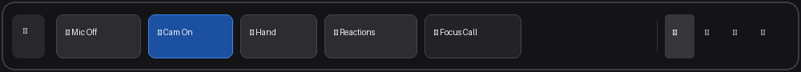

<div align="center">

# 🇺🇦 Проєкт розроблений українцем / Project developed by a Ukrainian 🇺🇦

[](https://stand-with-ukraine.pp.ua)

<p align="center">
  
</p>

# MacBook Pro Touch Bar for Google Meet
### 📹 Instant Mic, Camera, Hand, Reactions & Tab Focus from your Touch Bar

> [!IMPORTANT]
> 🔴 **HARDWARE REQUIREMENT / ВИМОГА ДО ПРИСТРОЮ**  
> Designed for **Apple MacBook Pro (2016–2020)** with physical **Touch Bar** running macOS Big Sur, Monterey, Ventura, Sonoma, or Sequoia.  
> Працює на всіх моделях MacBook Pro з сенсорною смугою Touch Bar!

[English Documentation](#-english) | [Українська версія](#-українська-версія)

---
</div>

<a name="english"></a>
## 🇬🇧 English

### ⚡ Overview
**MeetTouchBar** brings full, native hardware control over **Google Meet** directly to your MacBook Pro Touch Bar. Mute your microphone, toggle your camera, raise your hand, send animated emoji reactions, or switch focus directly to your meeting tab — all in one tap, with **0.0% CPU usage when idle**.

### ✨ Key Features
- **🎤 Smart Microphone Indicator:** Live status tracking. Bezel turns red when unmuted.
- **📹 Camera Indicator:** Live status tracking. Bezel turns blue when camera is active.
- **✋ Hand Raised:** Instantly raise/lower hand with orange visual alert.
- **💖 Emoji Reactions Bar:** Full row of quick emoji reactions (`💖`, `👍`, `🎉`, `👏`, `😂`, `😮`, `😢`, `🤔`, `👎`).
- **↗ Focus Meeting Tab:** Instantly brings the browser tab running the meeting to the foreground.
- **⚡ Ultra-low Resource Usage:** When no meetings are running, background polling stops completely (0.0% CPU, 0 network activity).

### 🚀 Installation
1. Download the latest **`MeetTouchBar-v1.0.0.zip`** from [Releases](https://github.com/mvmbmy0-gif/MeetTouchBar/releases).
2. Unzip the downloaded file.
3. Move `MeetTouchBar.app` to your Applications folder and launch it.
4. In Chrome / Brave / Edge, open `chrome://extensions`:
   - Enable **Developer mode** (top right switch).
   - Click **Load unpacked** (Завантажити розпаковане).
   - Select the `Extension` folder included in the release.
5. Join any Google Meet call — the Touch Bar buttons appear automatically!

### 🛠️ Building From Source
```bash
git clone https://github.com/mvmbmy0-gif/MeetTouchBar.git
cd MeetTouchBar
./build.sh
```

---

<a name="українська-версія"></a>
## 🇺🇦 Українська версія

### ⚡ Опис проєкту
**MeetTouchBar** — це нативна утиліта для macOS, яка перетворює сенсорну панель Touch Bar на повноцінний пульт керування **Google Meet**. Вмикайте та вимикайте мікрофон чи камеру, піднімайте руку, надсилайте емодзі-реакції та миттєво повертайтеся до вкладки дзвінка в один дотик.

### ✨ Основні можливості:
- **🎤 Індикатор мікрофона:** Підсвічується червоним кольором, коли мікрофон увімкнений.
- **📹 Індикатор камери:** Підсвічується синім кольором під час трансляції відео.
- **✋ Підняття руки:** Помаранчева кнопка для швидкої реакції на уроці чи зустрічі.
- **💖 Панель реакцій:** Окреме підменю Touch Bar із великими емодзі (`💖`, `👍`, `🎉`, `👏`, `😂`, `😮`, `😢`, `🤔`, `👎`).
- **↗ Кнопка «До уроку»:** Миттєво активує вікно браузера та перемикає на вкладку з поточним дзвінком.
- **⚡ Нульове навантаження на систему:** Коли дзвінок завершено або сайт Meet закритий, додаток не споживає процесор (0.0% CPU) та не розряджає батарею.

### 🚀 Встановлення та запуск:
1. Завантажте готовий архів **`MeetTouchBar-v1.0.0.zip`** зі сторінки [Релізів](https://github.com/mvmbmy0-gif/MeetTouchBar/releases).
2. Розархівуйте його.
3. Запустіть додаток `MeetTouchBar.app`.
4. У браузері (Chrome, Brave або Edge) відкрийте сторінку `chrome://extensions`:
   - Увімкніть перемикач **Режим розробника** (Developer mode).
   - Натисніть **Завантажити розпаковане розширення** (Load unpacked).
   - Оберіть папку `Extension` з архіву.
5. Увійдіть у будь-який дзвінок Google Meet — панель Touch Bar увімкнеться автоматично!

### 🛠️ Збірка проекту з вихідного коду:
```bash
git clone https://github.com/mvmbmy0-gif/MeetTouchBar.git
cd MeetTouchBar
./build.sh
```

---

### 📄 Ліцензія
Поширюється за відкритою ліцензією **MIT License**.
Розроблено в Україні 🇺🇦.
